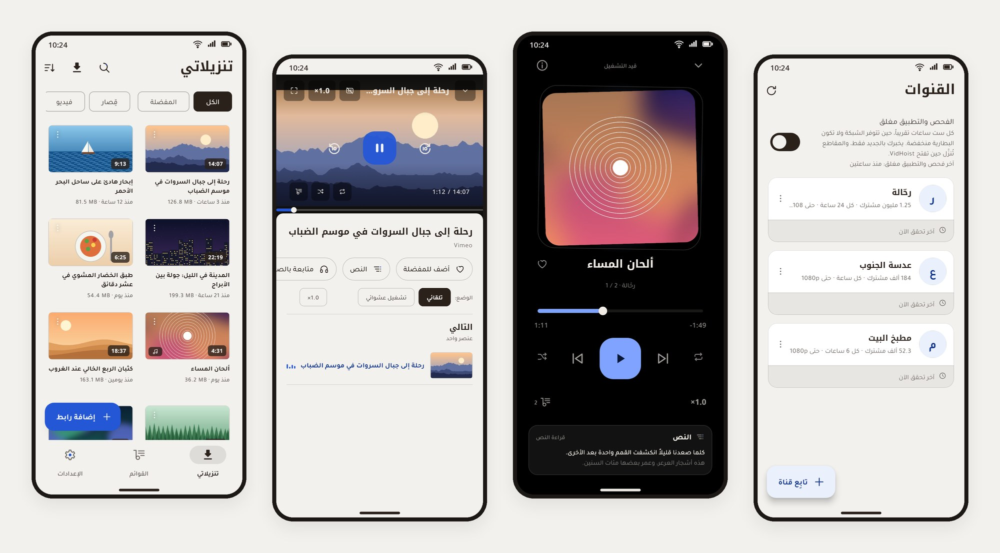
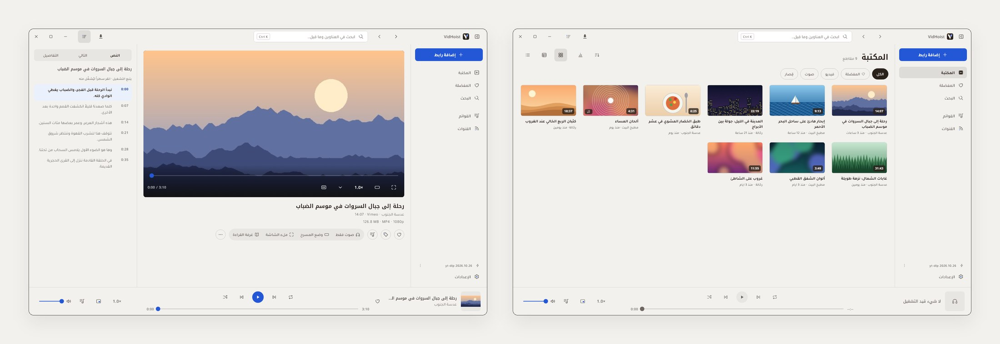
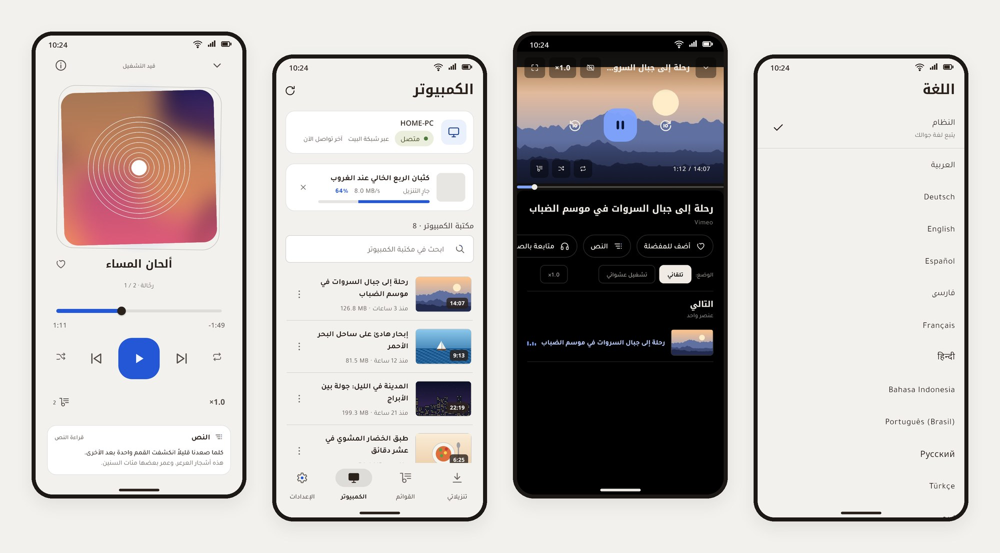
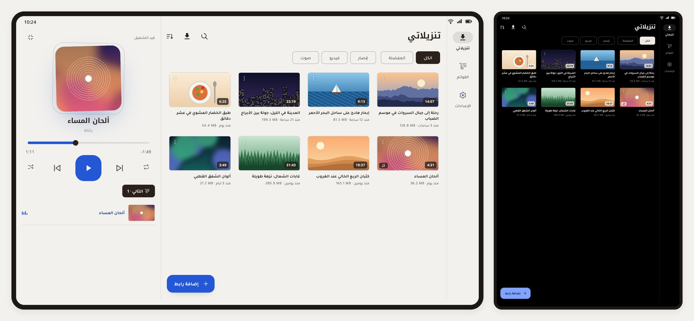
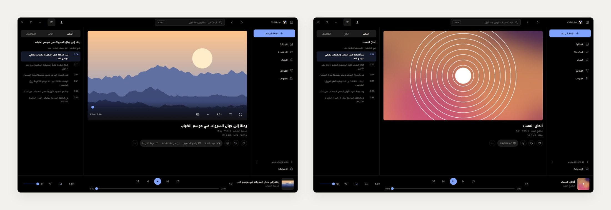

<div dir="rtl">

# VidHoist

[English](README.md) · **العربية**

</div>

[](https://github.com/sagheerys/vidhoist/actions/workflows/ci.yml)
[](https://github.com/sagheerys/vidhoist/actions/workflows/windows.yml)
[](https://github.com/sagheerys/vidhoist/releases/latest)
[](LICENSE)
[](#المتطلبات)
[](https://flutter.dev)
[](#الترجمة)

<div dir="rtl">

**نزّل الفيديو والصوت من الإنترنت إلى جوالك أو كمبيوترك مباشرة، بمحرّك
yt-dlp داخل التطبيق.** الصق الرابط أو شاركه، واختر الجودة، فيصير الملف لك:
في مكتبة تشغّله، وتعرض ترجمته، وتقرأ نصه معك، وتجد المقطع بأي كلمة **قيلت**
فيه لا بعنوانه فقط. بلا حساب، بلا سيرفر، بلا إعلانات، بلا تتبّع: ما تنزّله
يبقى بينك وبين الموقع. للجوالات والأجهزة اللوحية بأندرويد ولويندوز،
باثنتي عشرة لغة، من اليمين إلى اليسار أولاً، نهاراً وليلاً. برنامج حر
برخصة GPL.

<p align="center">
  
</p>

<p align="center">
  
</p>

| | **VidHoist لأندرويد** | **VidHoist لويندوز** |
|---|---|---|
| يعمل على | أندرويد 7.0 فما فوق، جوالات وأجهزة لوحية | ويندوز 10 و11 (64-بت) |
| المحرّك | yt-dlp وPython وffmpeg داخل التطبيق | yt-dlp بجانب التطبيق، وffmpeg وDeno يُنزَّلان عند أول حاجة |
| المكتبة | مجلد التنزيل، على الجوال أو بطاقة الذاكرة | مجلد التنزيل، شبكةً أو جدولاً أو قائمة مختصرة |
| التشغيل | فيديو بترجمته، والقِصار، وموسيقى في الخلفية | فيديو في النافذة أو نافذة صغيرة، وغرفة الاستماع |
| ما ينفرد به | تسجيل الدخول للمواقع، وصورة داخل صورة، وإرسال الروابط إلى الكمبيوتر | Ctrl+K، وغرفة القراءة، والقنوات، وسحب المقطع إلى المستكشف |
| التثبيت | ملف APK من صفحة الإصدارات، يحدّث نفسه | مثبّت من صفحة الإصدارات، يحدّث نفسه |

يتشارك التطبيقان الحزم نفسها: النواة، والوسائط، والتصميم، والنصوص، وyt-dlp،
وكلاهما **باثنتي عشرة لغة**: العربية، والإنجليزية، والإسبانية، والبرتغالية (البرازيل)، والفرنسية، والألمانية، والتركية، والروسية، والإندونيسية، والفارسية، والأردية، والهندية. ويتبع كل منهما لغة الجوال أو
ويندوز ما لم تختر غيرها.

## المزايا

<details>
<summary><strong>التنزيل</strong>، في التطبيقين: الروابط، والجودة، وجزء من الفيديو، والترجمة، وتسجيل الدخول، والمحرّك</summary>

**إدخال الرابط.** الصقه، أو دع زر الإضافة يلتقط رابطاً منسوخاً من قبل؛
وعلى الجوال شاركه إلى VidHoist من يوتيوب أو تيك توك أو أي تطبيق. التنزيل
السريع يرسله فوراً بجودتك المعتادة، والورقة الكاملة تتيح الاختيار. والروابط
المشاركة معاً تُعرض معاً، وقائمة التشغيل تُفتح قائمةً تختار منها المقاطع.

**ما تحصل عليه.** الأفضل، أو حد أعلى من 1080p حتى 360p، أو الصوت وحده
(M4A أو MP3 أو كما يرسله الموقع). يُحفظ الفيديو MP4 وغلافه داخل الملف،
فتبقى الصورة ولو حذفها الموقع. «أفضل توافق للتشغيل» يطلب H.264 وAAC أولاً
للجوالات التي يتقطّع فيها AV1. **جزء من المقطع فقط**: من وقت إلى وقت،
يُنزَّل وحده ويُحفظ مقطعاً مستقلاً بجانب الكامل.

**الترجمة.** اللغات التي تختارها (ست عشرة لغة، والعربية والإنجليزية
افتراضياً) تُحفظ بجانب كل مقطع لمشغّل التطبيق ونصه، ويمكن أن تدخل ملف
الفيديو أيضاً للمشغّلات الأخرى.

**المواقع التي تطلب تسجيل الدخول.** على الجوال سجّل الدخول إلى يوتيوب
وإنستغرام وفيسبوك وتيك توك وX وVimeo في صفحة الموقع نفسها داخل التطبيق،
أو استورد ملف `cookies.txt`؛ وعلى ويندوز استعمل ملف كوكيز أو كوكيز
المتصفح. يبقى الدخول على الجهاز ولا يُعطى إلا لـ yt-dlp.

**المحرّك يعتني بنفسه.** يتحدّث yt-dlp كل أسبوع، ومرة أخرى حين يفشل تنزيل
كما يفشل الإصدار القديم، ثم يُعاد التنزيل مرة بلا كلمة. و«أصلح المحرّك»
يعيد نسخة نظيفة حين تفشل التنزيلات في كل المواقع. التنزيلات تتوقف وتُستأنف،
وتستمر والتطبيق في الخلفية، ويمكن تحديد سرعتها أو تسريعها بالمقاطع
المتوازية، وعلى الجوال تنتظر Wi-Fi إن طلبت.

</details>

<details>
<summary><strong>المكتبة والمشغّلات</strong>: البحث، وقوائم التشغيل، والوسوم، والترجمة، والقِصار، والموسيقى</summary>

**المكتبة** هي ما نزّلته، على جهازك: الفيديو والصوت والقِصار،
منفصلة أو معاً، مرتّبة ومصفّاة، مع المفضّلة والوسوم وقوائم التشغيل
والقوائم الذكية. بحثها يجد العناوين و**ما قيل داخل المقاطع**، والكلمة
مضاءة في كل لحظة، ولمسة تشغّل من تلك الثانية. والكلمة العربية المكتوبة بلا
همزة أو تشكيل تجد ما كُتب بها.

**مشغّل الفيديو** يرسم الترجمة فوق الصورة بالحجم والخلفية اللذين تحبهما،
ويفتح نص المقطع تحت الفيديو والسطر الذي يُقال مضاء ومتابَع، ويكمل صوتاً
بلمسة، ويبقى في زاوية الشاشة (صورة داخل صورة) حين تترك التطبيق. والقِصار، أي
المقاطع العمودية القصيرة، تُفتح في مشغّل خاص بها.

**مشغّل الموسيقى** يستمر في الخلفية وأزراره في الإشعار وعلى شاشة القفل:
طابور، وتكرار وخلط، والسرعة، ونص المقطع والسطر الذي يُقال تحت الأزرار.

**الأجهزة اللوحية** لها تخطيطها: الطابور والنص يبقيان بجانب مشغّل الموسيقى
أو تحته.

</details>

<details>
<summary><strong>التنزيل على الكمبيوتر</strong>: الجوال يرسل الروابط إلى ويندوز ويشغّل مكتبته</summary>

مطفأ حتى تشغّله. اربط الجوال بالكمبيوتر مرة واحدة، برمز QR أو برمز وأربعة
أرقام تظهر على الشاشتين. بعدها يُرسل الرابط المضاف على الجوال إلى الكمبيوتر
فينزّله وأنت تكمل؛ وتبويب **الكمبيوتر** في الجوال يعرض تلك التنزيلات ومكتبة
الكمبيوتر، ويشغّل أي مقطع منها بنصه، وينسخه إلى الجوال، أو ينقله إلى سلة
محذوفات الكمبيوتر إن سمحت بذلك هناك. الروابط المرسلة والكمبيوتر غائب تنتظر
على الجوال وتُرسل حين يعود. يعمل على شبكة البيت أو عبر Tailscale، بـ HTTPS
وشهادة الكمبيوتر نفسه مثبّتة على الجوال. كيف بُني وكيف يُحمى:
[docs/PC-LINK.md](docs/PC-LINK.md).

</details>

<details>
<summary><strong>VidHoist لويندوز</strong>: Ctrl+K، وغرفتا القراءة والاستماع، والقنوات، ولوحة المفاتيح</summary>

- **Ctrl+K** يبحث في العناوين وفي ما قيل، ويشغّل الأوامر.
- **غرفة القراءة** تعرض النص مقالاً: انقر جملة لتسمعها من هناك، وابحث في
  النص، وصدّره PDF أو Markdown أو SRT.
- **غرفة الاستماع** تمرّر النص بأسطر كبيرة والصوت يعمل.
- **متابعة قناة**: كل فيديو جديد ينزل وحده بالجودة والمجلد وتصفية العنوان
  المختارة له، والتطبيق مفتوح أو في الدرج؛ والفحص الفائت والتطبيق مغلق يُجرى
  بعد فتحه بقليل. والجوال يتابع القنوات أيضاً.
- نافذة صغيرة للفيديو، و**سحب المقطع** إلى المستكشف ملفاً، وفتحه في مشغّل
  آخر، واستمرار الصوت في الدرج، والبدء مع ويندوز، واختصارات لوحة المفاتيح
  في كل مكان.

</details>

<details>
<summary><strong>الخصوصية والنسخ الاحتياطي والتحديث</strong></summary>

- **بلا حساب، بلا إعلانات، بلا تتبّع، بلا سيرفر لنا.** يتصل VidHoist
  بالمواقع التي تنزّل منها، وبـ GitHub ليفحص التحديث، وبكمبيوترك إن ربطته.
  لا شيء غير ذلك.
- **تسجيل الدخول** يتم في صفحة كل موقع نفسها داخل تطبيق الجوال. وما يتركه من
  ملفات تعريف يبقى على الجوال حيث يقرؤه yt-dlp، ولا يُرسَل إلى أي مكان.
- **النسخ الاحتياطية** ملفات JSON بلا أي سر: قوائم المكتبة والوسوم وقوائم
  التشغيل والقنوات والإعدادات. تُحفظ آخر سبع بجانب التنزيلات فلا يأخذها حذف
  التطبيق، ونسخة الجوال تُستعاد على الكمبيوتر والعكس.
- **التحديثات** من إصدارات هذا المستودع، ولا يُثبَّت الملف المنزَّل إلا إن
  طابق بصمة SHA-256 التي يسجّلها GitHub له.
- **سجل التشخيص** الذي تشاركه يُنظَّف أولاً من الروابط والمسارات والعناوين
  وبيانات الدخول.

</details>

## لقطات

<details>
<summary><strong>شاشات أخرى</strong>: المشغّلات، والكمبيوتر من الجوال، واللغات الاثنتا عشرة، والأجهزة اللوحية، وويندوز ليلاً</summary>
<br>

**المشغّلات والكمبيوتر**: مشغّل الموسيقى نهاراً، ومكتبة الكمبيوتر المقترن على
الجوال، ومقطع ليلاً، واللغات الاثنتا عشرة:



**على جهاز لوحي**: أفقياً، المكتبة ولوحة «قيد التشغيل» بجانبها؛ وعمودياً ليلاً،
المكتبة مع الشريط الجانبي:



**ويندوز ليلاً**: مقطع ونصّه، ومشغّل الموسيقى:



</details>

كل شاشة وحدها، باللغتين ونهاراً وليلاً، في [docs/screenshots](docs/screenshots).
المقاطع والقنوات والأغلفة فيها مصنوعة لهذا الغرض، فلا تظهر فيها مقاطع أحد.
ترسمها ودجات التطبيقين نفسها: `VH_SHOTS=1 flutter test test/screenshots` في
أي من التطبيقين، ثم `python tool/screenshots/frame.py` للإطارات.

## التنزيل

من [آخر إصدار](https://github.com/sagheerys/vidhoist/releases/latest):

| الملف | لـ |
|---|---|
| `Vidhoist-<version>-android-arm64-v8a.apk` | كل جوال وجهاز لوحي بأندرويد تقريباً من السنوات العشر الأخيرة |
| `Vidhoist-<version>-android-armeabi-v7a.apk` | الأجهزة القديمة بنظام 32-بت |
| `Vidhoist-<version>-windows-x64-setup.exe` | ويندوز 10 و11 |

يفحص التطبيقان الإصدار الجديد ويعرضانه في مكانهما، فلا تحتاج شيئاً آخر
لتبقى محدَّثاً. ملفات APK موقّعة بمفتاح VidHoist الخاص، وبصمة شهادته
SHA-256 هي:

</div>

`93:CF:C4:66:1F:3F:42:92:24:F5:85:D3:F8:6A:96:D2:72:06:21:DB:90:64:A1:A0:13:41:88:F7:2B:A5:3B:F2`

<div dir="rtl">

## المتطلبات

- **أندرويد 7.0** (API 24) فما فوق. نحو 65 ميغابايت للتطبيق، لأن yt-dlp
  وPython وffmpeg داخله.
- **ويندوز 10 أو 11، 64-بت.** يأتي yt-dlp مع المثبّت، وffmpeg وDeno
  يُنزَّلان أول مرة يحتاجهما تنزيل، وكل منهما يُفحص ببصمة SHA-256 مثبّتة.

## البناء من المصدر

Flutter 3.47 فما فوق (Dart ^3.13). من جذر المستودع:

</div>

```bash
flutter pub get
cd packages/vh_ui && flutter gen-l10n && cd ../..
flutter analyze --no-pub
cd apps/vidhoist_mobile  && flutter build apk --debug
cd apps/vidhoist_desktop && flutter build windows --debug
```

<div dir="rtl">

بناء ويندوز يحتاج «Desktop development with C++» في Visual Studio مع ATL،
وRust (إحدى الإضافات تُبنى بـ cargo). الأيقونات وملفات الهوية تُولَّد ولا
تُرسم يدوياً: `python tool/icons/vidhoist_kit.py`، ثم
`dart run flutter_launcher_icons` في تطبيق أندرويد.

## خريطة المستودع

</div>

```
apps/vidhoist_mobile     تطبيق أندرويد
apps/vidhoist_desktop    تطبيق ويندوز
packages/vh_core         Dart خالص: النماذج، والتخزين، ومحرّك التنزيل، والنسخ الاحتياطي، والتحديث، وربط الجوال
packages/vh_media        المشغّلات، والمشغّل المصغّر، وجلسة الوسائط
packages/vh_ui           نظام التصميم: الرموز، والأيقونات، والمكوّنات، ونصوص كل اللغات
packages/vh_transcripts  Dart خالص: الترجمة، والنصوص، والبحث في ما قيل
packages/vh_ytdlp        Dart خالص: أوامر yt-dlp وقراءة ما يطبعه
third_party/             ثلاث إضافات معدّلة، في كل منها PATCHES.md
docs/                    البنية، والمحرّك، وربط الجوال، والقرارات (adr/)
tool/                    توليد الأيقونات، وفحص التعليقات، وجلب المحرّك للمثبّت
```

<div dir="rtl">

## الاختبارات

</div>

```bash
cd packages/vh_core && dart test          # وكذلك vh_transcripts وvh_ytdlp
cd packages/vh_media && flutter test      # وكذلك vh_ui وapps/vidhoist_mobile
cd apps/vidhoist_desktop && flutter test -j 2
python tool/comment-lint.py
```

<div dir="rtl">

كل شاشة تُفحص على مصفوفة من الجوالات والأجهزة اللوحية وأحجام النوافذ بثلاثة
أحجام خط، باللغتين، فلا يتجاوز شيء إطاره. وكل عطل يُصلَح يترك اختباراً كان
يفشل قبل الإصلاح.

## الترجمة

النصوص في `packages/vh_ui/lib/src/l10n/`: الملف `app_en.arb` هو الأصل،
ولكل لغة ملفها `app_<code>.arb`، واختبار يبقيها مطابقة له. العربية
والإنجليزية تُكتبان مع التطبيق، واللغات العشر الأخرى ترجمات أولى نرحّب
بتصحيح أهلها لها. التخطيط من اليمين إلى اليسار أولاً، للعربية والفارسية
والأردية معاً. طريقة تصحيح لغة أو إضافة أخرى في
[CONTRIBUTING.md](CONTRIBUTING.md#translations).

## الوثائق

- [docs/ARCHITECTURE.md](docs/ARCHITECTURE.md): الحزم، وقاعدة الاعتماد، وأين
  توضع الميزة.
- [docs/ENGINE.md](docs/ENGINE.md): yt-dlp على ويندوز وأندرويد، والقياسات،
  والفخاخ، والتخزين والنسخ الاحتياطي.
- [docs/PC-LINK.md](docs/PC-LINK.md): التنزيل على الكمبيوتر، والربط، والأمان،
  والبروتوكول.
- [docs/adr/](docs/adr/): القرارات التي لا تُغيَّر بسهولة.
- [CONTRIBUTING.md](CONTRIBUTING.md) · [SECURITY.md](SECURITY.md) ·
  [CODE_OF_CONDUCT.md](CODE_OF_CONDUCT.md) · [CHANGELOG.md](CHANGELOG.md)

الوثائق بالإنجليزية، والبلاغات تُقبل بالعربية أو بالإنجليزية.

## شكر

يقوم VidHoist على [yt-dlp](https://github.com/yt-dlp/yt-dlp) الذي يتولّى
التنزيل، و[FFmpeg](https://ffmpeg.org)، و[Deno](https://deno.com) على ويندوز.
وعلى أندرويد يعمل yt-dlp عبر
[youtubedl-android](https://github.com/yausername/youtubedl-android)، ويُقرأ
رمز الربط بمكتبة
[ZXing Android Embedded](https://github.com/journeyapps/zxing-android-embedded).
بُني التطبيقان بـ [Flutter](https://flutter.dev)، ويشغّلان الوسائط بـ
[media_kit](https://github.com/media-kit/media-kit) و
[just_audio](https://github.com/ryanheise/just_audio) و
[audio_service](https://github.com/ryanheise/audio_service). شكراً لكل من
يقف خلفها.

## الرخصة

GPL-3.0. حقوق النشر © 2026 Yasir Sagheer. الإضافات في `third_party/` تحتفظ
برخصها.

البرامج التي يحملها كل تطبيق (FFmpeg وPython وyt-dlp وlibmpv وغيرها) ورخصها
ومصادرها مذكورة في [docs/THIRD-PARTY.md](docs/THIRD-PARTY.md)، ومصدر كل ما
رخصته GPL أو LGPL مرفق مع كل إصدار.

VidHoist غير مرتبط بـ yt-dlp ولا بأي موقع. نزّل ما يحق لك فقط، واحترم شروط
المواقع التي تستعملها.

</div>
