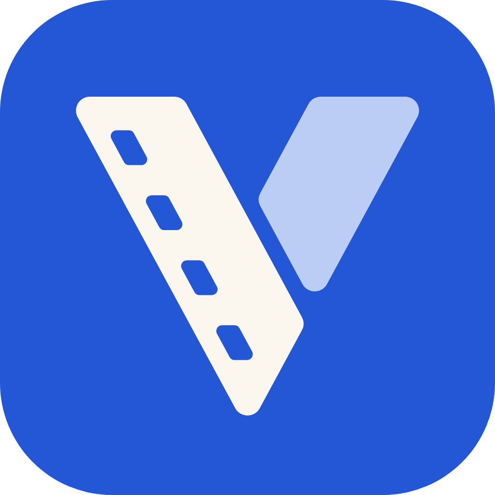
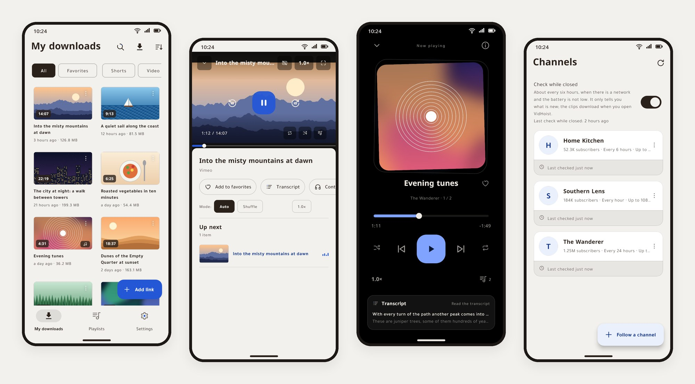
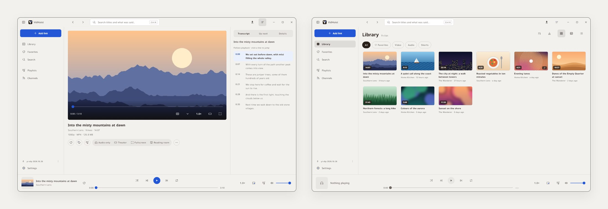
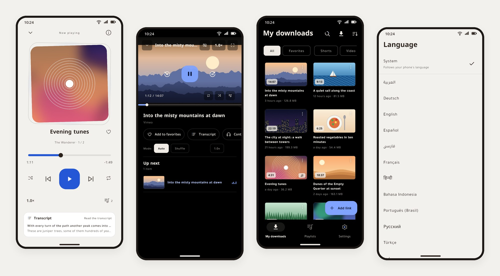
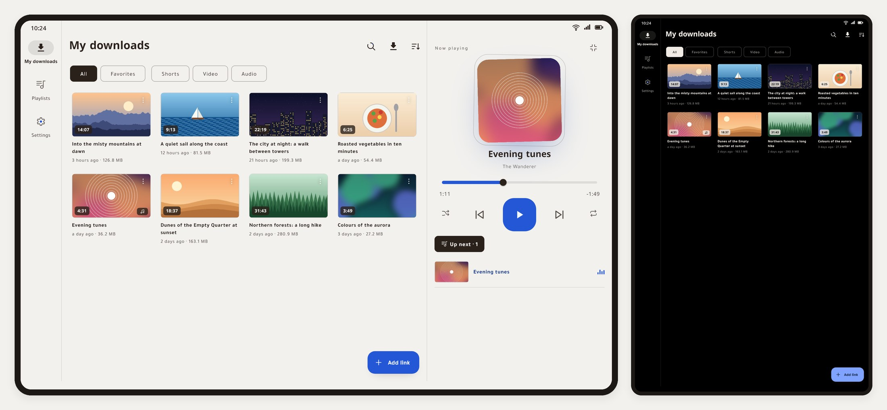
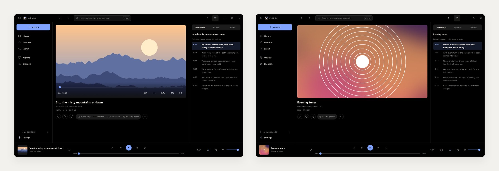

<p align="center">
  
</p>

<h1 align="center">VidHoist</h1>

<p align="center">
  <strong>Video and audio from the web, kept on your phone and your computer, and searchable by what was said.</strong>
</p>

<p align="center">
  <strong>English</strong> · <a href="README.ar.md">العربية</a>
</p>

<div align="center">

[](https://github.com/sagheerys/vidhoist/actions/workflows/ci.yml)
[](https://github.com/sagheerys/vidhoist/actions/workflows/windows.yml)
[](https://github.com/sagheerys/vidhoist/releases/latest)
[](LICENSE)
[](#requirements)
[](https://flutter.dev)
[](#translations)

</div>

**Download video and audio from the web, straight to your phone or your
computer, with yt-dlp built into the app.** Paste or share a link, pick a
quality, and the file is yours: in a library that plays it, shows its
subtitles, reads its transcript along with you, and finds the clip by
anything that was **said** in it, not only by its title. No account, no
server, no ads, no tracking: what you download stays between you and the
site. For Android phones and tablets and for Windows, in twelve
languages, right-to-left first, by day and by night. Free software under the
GPL.

<p align="center">
  
</p>

<p align="center">
  
</p>

## At a glance

- **Search by what was said.** The library finds a clip by any word spoken
  in it, lights the word in each moment, and plays from that second.
- **Any site yt-dlp knows**, at the quality you choose, or the sound alone,
  or only a part of the video, with its subtitles in the languages you pick.
- **Players made for reading along.** Video with subtitles and its
  transcript under it, music that keeps playing in the background, shorts in
  a reels player, picture in picture.
- **Download on the computer from the phone.** Pair once by QR code; the
  phone sends links to Windows, watches them download, and plays the
  computer's library.
- **Follow channels.** Windows downloads each new video by itself; the phone
  checks while it is closed, about every six hours, and tells you what is
  new.
- **Twelve languages, right-to-left first**, by day and by night, on
  phones, tablets and Windows.
- **Private by design.** No account, no server, no ads, no tracking.
  Backups move between the phone and the computer.
- **Looks after itself.** The engine updates and repairs itself, and the
  apps update from this repository's releases.

| | **VidHoist for Android** | **VidHoist for Windows** |
|---|---|---|
| Runs on | Android 7.0 and later, phones and tablets | Windows 10 and 11 (x64) |
| The engine | yt-dlp, Python and ffmpeg inside the app | yt-dlp beside the app; ffmpeg and Deno fetched on first need |
| The library | the download folder, on the phone or a memory card | the download folder, as a grid, a table or a compact list |
| Playback | video with subtitles, shorts, music in the background | video in the window or a small window, the listening room |
| Only here | sign-ins to sites, picture in picture, sends links to the computer | Ctrl+K, the reading room, channels, drag a clip out to Explorer |
| Installs | an APK from Releases, updates itself | an installer from Releases, updates itself |

Both apps share the same core, media, design, transcript and yt-dlp
packages, and both ship in **twelve languages**: English, Arabic, Spanish, Portuguese (Brazil), French, German, Turkish, Russian, Indonesian, Persian, Urdu and Hindi. Each
follows the phone's or Windows' own language unless you choose another.

## Features

<details>
<summary><strong>Downloading</strong>, in both apps: links, qualities, parts of a video, subtitles, sign-ins, the engine</summary>

**Getting a link in.** Paste it, or let the add button notice a link
already on the clipboard; on the phone, share it to VidHoist from YouTube,
TikTok or any app. Quick download sends it straight away at your usual
quality; the full sheet lets you choose. Several links shared at once are
offered together, and a playlist opens as a list to tick the clips you want.

**What you get.** Best, or a ceiling from 1080p down to 360p, or audio
only (M4A, MP3, or as the site sends it). Videos are saved as MP4 with
their cover inside the file, so the picture stays even if the site deletes
it. "Best playback compatibility" asks for H.264 and AAC first, for phones that
stutter on AV1. **Only a part of the video**: from one time to another,
fetched alone and kept as its own clip beside the whole one.

**Subtitles.** The languages you choose (sixteen offered, Arabic and
English by default) are saved beside each clip for the app's player and
transcript, and can go inside the video file too, for other players.

**Sites that want a sign-in.** On the phone, sign in to YouTube, Instagram,
Facebook, TikTok, X or Vimeo on the site's own page inside the app, or
import a `cookies.txt`; on Windows, use a cookies file or a browser's
cookies. The sign-in stays on the device and is passed to yt-dlp alone.

**The engine looks after itself.** yt-dlp updates weekly, and again when a
download fails the way an outdated build fails, then the download tries
once more without a word. "Repair the engine" puts back a clean copy when
downloads fail everywhere. Downloads pause and resume, carry on with the
app in the background, can be limited in speed or sped up with segmented
streams, and on the phone wait for Wi-Fi if you ask.

</details>

<details>
<summary><strong>The library and the players</strong>: search, playlists, tags, subtitles, shorts, music</summary>

**The library** is what you downloaded, on the device: videos, audio and
shorts apart or together, sorted and filtered, with favourites, tags,
playlists and smart playlists. Its search finds titles and **what was said
inside the clips**, the word lit in each moment, and a tap plays from that
second. Arabic typed without its marks finds the words as written.

**The video player** draws the subtitles over the picture at the size and
background you like, opens the transcript under the video with the line
being said lit and followed, carries on as audio at a tap, and stays in a
corner in picture in picture when you leave the app. Short portrait clips open in a
reels player.

**The music player** keeps playing in the background with its controls in
the notification and on the lock screen: a queue, repeat and shuffle, the
speed, and the transcript, the line being said under the controls.

**Tablets** get layouts of their own: the queue and the transcript stay
beside the music player or under it.

</details>

<details>
<summary><strong>Download on the computer</strong>: the phone sends links to Windows and plays its library</summary>

Off until you turn it on. Pair the phone with the computer once, by a QR
code or a code and four digits both screens show. Then a link added on the
phone can be sent to the computer, which downloads it while you go on; the
phone's **Computer** tab shows those downloads and the computer's library,
plays any clip from it with its transcript, copies one to the phone, or
moves it to the computer's Recycle Bin if you allowed that there. Links
sent while the computer is away wait on the phone and go when it is back.
It works on the home network or over Tailscale, through HTTPS with the
computer's own certificate pinned on the phone. How it is built and
secured: [docs/PC-LINK.md](docs/PC-LINK.md).

</details>

<details>
<summary><strong>VidHoist for Windows</strong>: Ctrl+K, the reading and listening rooms, channels, the keyboard</summary>

- **Ctrl+K** searches titles and what was said, and runs commands.
- **The reading room** shows a transcript as an article: click a sentence
  to hear it from there, find in the text, export it as PDF, Markdown or
  SRT.
- **The listening room** lets the transcript flow past in large lines
  while the sound plays.
- **Follow a channel**: each new video downloads by itself at the quality,
  in the folder and through the title filter chosen for it, while the app
  is open or in the tray; a check missed while it was closed is made soon
  after it opens. The phone follows channels too, and can check them while
  it is closed, about every six hours on a network and a battery that is
  not low: it tells you what is new, and the clips download when you open
  VidHoist.
- A small window for the video, **drag a clip out** to Explorer as its
  file, open it in another player, keep the sound playing in the tray,
  start with Windows, and keyboard shortcuts throughout.

</details>

<details>
<summary><strong>Privacy, backups and updates</strong></summary>

- **No account, no ads, no tracking, no server of ours.** VidHoist talks to
  the sites you download from, to GitHub to check for an update, and to
  your own computer if you pair it. Nothing else.
- **Sign-ins** happen on each site's own page inside the phone app. The
  cookies a sign-in leaves stay on the phone, where yt-dlp reads them, and
  are sent nowhere else.
- **Backups** are plain JSON with no secret in them: the library's lists,
  tags, playlists, channels and settings. The last seven are kept beside
  the downloads, so an uninstall does not take them; a phone's backup
  restores on the computer and the other way round.
- **Updates** come from this repository's releases, and a downloaded file is
  installed only if it matches the SHA-256 GitHub records for it.
- **A diagnostic log** you can share is scrubbed first of links, paths,
  addresses and credentials.

</details>

## Screenshots

**The players and the computer** — the music player by day, the paired
computer's library on the phone, a video at night, and the twelve languages:



**On a tablet** — held sideways, the library with the "Now playing" panel
beside it; upright, at night, the library with the rail:



**Windows at night** — a video with its transcript, and the music player:



Every screen, one by one, in both languages and by day and by night, is in
[docs/screenshots](docs/screenshots). The clips, channels and covers in them
are made up for the purpose, so they show nobody's videos. The apps' own
widgets draw them: `VH_SHOTS=1 flutter test test/screenshots` in either app,
then `python tool/screenshots/frame.py` for the frames.

## Download

From the [latest release](https://github.com/sagheerys/vidhoist/releases/latest):

| File | For |
|---|---|
| `Vidhoist-<version>-android-arm64-v8a.apk` | almost every Android phone and tablet from the last ten years |
| `Vidhoist-<version>-android-armeabi-v7a.apk` | older 32-bit devices |
| `Vidhoist-<version>-windows-x64-setup.exe` | Windows 10 and 11 |

Both apps check for a new release and offer it in place; nothing else is
needed to stay up to date. The APKs are signed with VidHoist's own key,
whose SHA-256 certificate fingerprint is
`93:CF:C4:66:1F:3F:42:92:24:F5:85:D3:F8:6A:96:D2:72:06:21:DB:90:64:A1:A0:13:41:88:F7:2B:A5:3B:F2`.

## Requirements

- **Android 7.0** (API 24) or later. About 65 MB for the app, since yt-dlp,
  Python and ffmpeg travel inside it.
- **Windows 10 or 11, 64-bit.** yt-dlp comes with the installer; ffmpeg and
  Deno are fetched the first time a download needs them, each checked
  against a pinned SHA-256.

## Building from source

Flutter 3.47 or later (Dart ^3.13). From the repository root:

```bash
flutter pub get
cd packages/vh_ui && flutter gen-l10n && cd ../..
flutter analyze --no-pub
cd apps/vidhoist_mobile  && flutter build apk --debug
cd apps/vidhoist_desktop && flutter build windows --debug
```

Building for Windows needs Visual Studio's "Desktop development with C++"
with ATL, and Rust (one plugin is built with cargo). Icons and brand files
are generated, not drawn by hand: `python tool/icons/vidhoist_kit.py`,
then `dart run flutter_launcher_icons` in the Android app.

## Repository layout

```
apps/vidhoist_mobile     the Android app
apps/vidhoist_desktop    the Windows app
packages/vh_core         pure Dart: models, storage, the download engine, backup, update, the phone link
packages/vh_media        the players, the mini player, the media session
packages/vh_ui           the design system: tokens, icons, components, the strings in every language
packages/vh_transcripts  pure Dart: subtitles, transcripts and the search over what was said
packages/vh_ytdlp        pure Dart: yt-dlp's command lines and reading what it prints
third_party/             three patched plugins, each with its PATCHES.md
docs/                    the architecture, the engine, the phone link, decisions (adr/)
tool/                    icon generation, the comment lint, the engine fetch for the installer
```

## Tests

```bash
cd packages/vh_core && dart test          # also vh_transcripts, vh_ytdlp
cd packages/vh_media && flutter test      # also vh_ui and apps/vidhoist_mobile
cd apps/vidhoist_desktop && flutter test -j 2
python tool/comment-lint.py
```

Every screen is checked on a matrix of phones, tablets and window sizes
at three text sizes, in both languages, so nothing overflows. Every fixed
defect leaves a test that failed before the fix.

## Translations

The strings live in `packages/vh_ui/lib/src/l10n/`: `app_en.arb` is the
source and each language has its own `app_<code>.arb`, which a test keeps
in step with it. English and Arabic are written with the app; the other ten
are first translations, and corrections from native speakers are welcome.
The layout is right-to-left first, for Arabic, Persian and Urdu alike. How
to correct a language or add one is in
[CONTRIBUTING.md](CONTRIBUTING.md#translations).

## Documentation

- [docs/ARCHITECTURE.md](docs/ARCHITECTURE.md): the packages, the
  dependency rule, where a feature goes.
- [docs/ENGINE.md](docs/ENGINE.md): yt-dlp on Windows and Android, the
  measurements, the traps, storage and backups.
- [docs/PC-LINK.md](docs/PC-LINK.md): download on the computer, pairing,
  security and the protocol.
- [docs/adr/](docs/adr/): the decisions that are not changed lightly.
- [CONTRIBUTING.md](CONTRIBUTING.md) · [SECURITY.md](SECURITY.md) ·
  [CODE_OF_CONDUCT.md](CODE_OF_CONDUCT.md) · [CHANGELOG.md](CHANGELOG.md)

## Credits

VidHoist stands on [yt-dlp](https://github.com/yt-dlp/yt-dlp), which does
the downloading, [FFmpeg](https://ffmpeg.org), and
[Deno](https://deno.com) on Windows. On Android, yt-dlp runs through
[youtubedl-android](https://github.com/yausername/youtubedl-android), and
the pairing code is read with
[ZXing Android Embedded](https://github.com/journeyapps/zxing-android-embedded).
The apps are built with [Flutter](https://flutter.dev), and play with
[media_kit](https://github.com/media-kit/media-kit),
[just_audio](https://github.com/ryanheise/just_audio) and
[audio_service](https://github.com/ryanheise/audio_service). Thanks to
everyone behind them.

## License

GPL-3.0. Copyright © 2026 Yasir Sagheer. The plugins in `third_party/`
keep their own licences.

The programs each app carries (FFmpeg, Python, yt-dlp, libmpv and others),
their licences and their sources are listed in
[docs/THIRD-PARTY.md](docs/THIRD-PARTY.md); the source of every GPL and LGPL
one is attached to each release.

VidHoist is not affiliated with yt-dlp or with any site. Download only what
you have the right to, and respect the terms of the sites you use.
